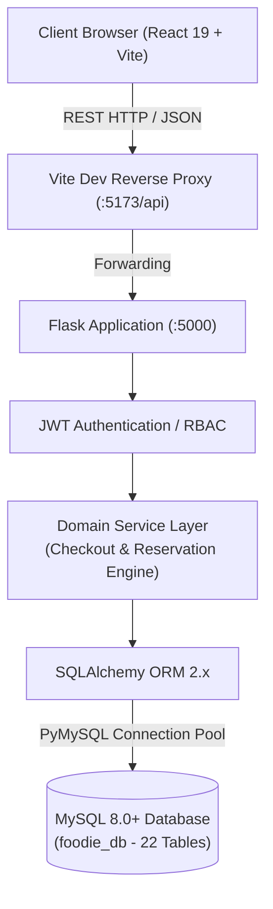

# Foodie — System Architecture & Design Specification

## 1. System Overview

**Foodie** is an enterprise-grade full-stack food delivery and restaurant table reservation platform built for academic examination and real-world reference. The system integrates a high-performance Single Page Application (SPA) frontend, a modular Python Flask micro-monolith API, and a normalized MySQL relational database engine.

---

## 2. Architectural Layers

### 2.1 Presentation Layer (Frontend)
- **Framework**: React 19 bootstrapped with Vite for instant Hot Module Replacement (HMR).
- **Routing**: React Router v7 with declarative route guards (`ProtectedRoute`, `AdminRoute`).
- **State Management**:
  - `AuthContext`: Centralized JWT authentication token storage, user session persistence (`localStorage`), profile synchronization, and login/logout broadcast.
  - `CartContext`: Client-side persistent cart synchronization with multi-restaurant conflict prevention, optimistic calculations, and coupon preview.
- **Styling**: Tailored design system implemented via CSS variables in `index.css`:
  - Primary color palette: Warm Cream (`#FAF7F2`), Rich Saffron/Orange (`#F97316`), Deep Charcoal (`#1F2937`).
  - Micro-interactions, skeleton loading states, badges, and responsive CSS grid/flexbox layouts.

### 2.2 Application / API Layer (Backend)
- **Framework**: Flask 3.x using the **Application Factory Pattern** (`create_app`).
- **Modularity**: Flask Blueprints partitioning domain responsibilities:
  - `auth`: Registration, credential verification, JWT issuance, profile updates.
  - `restaurants`: Restaurant listings, geo/cuisine filters, categorized menu trees.
  - `cart`: Server-persisted cart synchronizer with item customization notes.
  - `orders`: Order calculation, ACID checkout placement, tracking, cancellations.
  - `reservations`: Slot availability evaluation, conflict-safe table reservations.
  - `reviews`: Customer feedback and aggregate rating automation.
  - `coupons`: Promo code verification and tier-based discounts.
  - `addresses`: User address book for delivery dispatch.
  - `admin`: Back-office metrics, status state machines, and inventory CRUD.
- **Routing Compatibility**: Every blueprint is mounted with dual routing support:
  - Modern canonical route: `/api/v1/<blueprint>`
  - Legacy/fallback route: `/api/<blueprint>`

### 2.3 Service Layer (Business Logic)
- **`CheckoutService`**:
  - Implements an atomic multi-table checkout workflow.
  - **Server-Side Price Verification**: Never trusts prices submitted from client payloads; re-queries database menu item records inside transaction locks.
  - **Snapshot Preservation**: Captures immutable price and item name snapshots in `order_items` at checkout time.
  - Applies coupons with subtotal thresholds and usage caps.
  - Atomically flushes active cart items and creates an associated payment ledger entry.
- **`ReservationService`**:
  - Evaluates table capacity against requested party sizes.
  - Enforces reservation buffer intervals (default 2 hours) to prevent double-booking.
  - Uses transactional validation to avoid race conditions during simultaneous bookings.

### 2.4 Data Persistence Layer
- **Engine**: MySQL 8.0+ configured with `utf8mb4` character set.
- **ORM**: SQLAlchemy with declarative base mappings.
- **Connection**: `PyMySQL` driver with connection pooling.
- **Integrity**: Foreign key cascading constraints, check constraints, stored procedures, and triggers for real-time aggregation.

---

## 3. Security Architecture

1. **Password Security**:
   - Werkzeug PBKDF2 with SHA-256 and 600,000 hash iterations.
   - Salt auto-generation per user; zero plaintext storage.
2. **Stateless JWT Authorization**:
   - RFC 7519 compliant JSON Web Tokens signed with HMAC-SHA256.
   - Payload includes `sub` (stringified user ID), `role`, `iat`, and `exp` (24-hour expiration).
   - `@token_required` and `@role_required` decorators enforce RBAC on restricted endpoints.
3. **Defense in Depth**:
   - Server-side price recalculation guards against client tampering.
   - Role verification checked against database/token state, never client form inputs.
   - Strict CORS policy restricting requests to validated frontend origins.
   - SQL injection immunization via SQLAlchemy parameterized queries.
