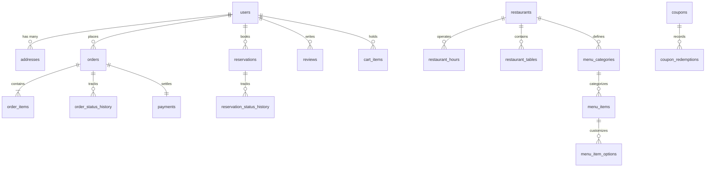

# Foodie — Database Design & Schema Specification

## 1. Schema Overview

The `foodie_db` relational database comprises **22 normalized tables** structured to balance **Third Normal Form (3NF)** compliance with targeted, documented performance denormalization.

---

## 2. Table Catalog

### 2.1 User Management
1. **`users`**: Core user entity (`id`, `name`, `email` [UNIQUE], `password_hash`, `phone`, `role` [customer/restaurant_owner/admin], `is_active`, `avatar_url`, `created_at`).
2. **`addresses`**: Saved delivery addresses (`id`, `user_id`, `address_line1`, `address_line2`, `city`, `state`, `postal_code`, `is_default`, `delivery_instructions`).

### 2.2 Restaurant & Operations
3. **`restaurants`**: Restaurant profiles (`id`, `owner_id`, `name`, `slug` [UNIQUE], `cuisine_type`, `phone`, `email`, `address`, `city`, `rating`, `rating_count`, `delivery_fee`, `estimated_delivery_time`, `is_pure_veg`, `is_active`).
4. **`restaurant_hours`**: Operating time windows per day of week (`id`, `restaurant_id`, `day_of_week` [0-6], `opening_time`, `closing_time`, `is_closed`).
5. **`restaurant_tables`**: Physical table inventory for reservations (`id`, `restaurant_id`, `table_number`, `seating_capacity`, `section` [indoor/outdoor/terrace/private], `is_active`).

### 2.3 Catalog & Menu
6. **`menu_categories`**: Groupings per restaurant (`id`, `restaurant_id`, `name`, `display_order`, `is_active`).
7. **`menu_items`**: Dish offerings (`id`, `restaurant_id`, `category_id`, `name`, `description`, `price`, `is_vegetarian`, `is_available`, `image_url`, `calories`, `preparation_time`).
8. **`menu_item_options`**: Modifiers/add-ons (`id`, `menu_item_id`, `option_name`, `additional_price`, `is_required`).

### 2.4 Cart & Checkout
9. **`cart_items`**: Server-persisted shopping cart (`id`, `user_id`, `menu_item_id`, `quantity`, `customization_notes`, `created_at`).
10. **`orders`**: Order header record (`id`, `order_number` [UNIQUE], `user_id`, `restaurant_id`, `delivery_address_text`, `status` [placed/confirmed/preparing/out_for_delivery/delivered/cancelled], `subtotal`, `tax_amount`, `delivery_fee`, `discount_amount`, `total_amount`, `payment_method`, `payment_status`, `coupon_code`).
11. **`order_items`**: Line item detail with **historical price snapshot** (`id`, `order_id`, `menu_item_id`, `item_name`, `unit_price`, `quantity`, `subtotal`, `customization_notes`).
12. **`order_status_history`**: Audit trail of order status transitions (`id`, `order_id`, `previous_status`, `new_status`, `changed_at`, `notes`).

### 2.5 Table Reservations
13. **`reservations`**: Booking details (`id`, `reservation_code` [UNIQUE], `user_id`, `restaurant_id`, `table_id`, `reservation_date`, `reservation_time`, `party_size`, `status` [pending/confirmed/completed/cancelled], `special_requests`).
14. **`reservation_status_history`**: Audit trail of booking transitions (`id`, `reservation_id`, `previous_status`, `new_status`, `changed_at`, `notes`).

### 2.6 Financial & Promotions
15. **`coupons`**: Discount promotions (`id`, `code` [UNIQUE], `discount_type` [percentage/fixed], `discount_value`, `min_order_amount`, `max_discount_amount`, `valid_from`, `valid_until`, `usage_limit`, `times_used`, `is_active`).
16. **`coupon_redemptions`**: Tracks user redemption of coupons (`id`, `coupon_id`, `user_id`, `order_id`, `discount_applied`, `redeemed_at`).
17. **`payments`**: Payment ledger records (`id`, `order_id`, `transaction_reference`, `amount`, `payment_method`, `payment_status`, `processed_at`).

### 2.7 Social & Operational
18. **`reviews`**: Ratings and reviews on restaurants (`id`, `user_id`, `restaurant_id`, `order_id`, `rating` [1-5], `comment`, `created_at`).
19. **`favorites`**: User bookmark list (`id`, `user_id`, `restaurant_id`, `created_at`).
20. **`delivery_assignments`**: Rider dispatch (`id`, `order_id`, `driver_name`, `driver_phone`, `vehicle_number`, `assigned_at`, `status`).
21. **`notifications`**: Customer and system notifications (`id`, `user_id`, `title`, `message`, `is_read`, `created_at`).
22. **`audit_logs`**: System and security event tracking (`id`, `user_id`, `action`, `entity_type`, `entity_id`, `details`, `ip_address`, `created_at`).

---

## 3. Justified Denormalization Analysis

1. **Snapshot Preservation in `order_items`**:
   - `item_name` and `unit_price` are captured explicitly in `order_items` at transaction time.
   - **Reason**: Protects historical financial accuracy. If a restaurant increases the price of "Dum Biryani" from ₹350 to ₹400 next week, previous receipts must permanently record ₹350.
2. **Aggregated Ratings on `restaurants`**:
   - `rating` and `rating_count` are stored on the `restaurants` row and maintained asynchronously or via triggers.
   - **Reason**: Eliminates the overhead of calculating `AVG(rating)` and `COUNT(*)` across millions of review rows every time a customer browses the restaurant listing page.

---

## 4. Triggers, Views & Stored Procedures

### Triggers
1. **`trg_after_order_status_update`**:
   - Fires `AFTER UPDATE ON orders`.
   - Automatically writes an entry into `order_status_history` whenever `status` changes.
   - Generates a customer notification in `notifications`.
2. **`trg_after_reservation_status_update`**:
   - Fires `AFTER UPDATE ON reservations`.
   - Records historical status shifts to ensure audit compliance.
3. **`trg_after_review_insert`**:
   - Fires `AFTER INSERT ON reviews`.
   - Recomputes the restaurant's average rating and total review count in real time.

### Views
1. **`v_restaurant_menu`**: Flattens restaurants, categories, and menu items for catalog consumption.
2. **`v_order_summary`**: Enriches orders with customer name, restaurant name, item count, and payment state.
3. **`v_restaurant_performance`**: Analytical view aggregating lifetime revenue, order volume, and active menu items.

### Stored Procedures
1. **`sp_create_order_atomic`**:
   - Full ACID transaction handling order placement in pure SQL.
   - Validates cart contents, locks menu items for update, verifies stock, inserts header & details, clears cart, logs status, and commits or rolls back on error.
2. **`sp_generate_sales_report`**:
   - Accepts date boundaries (`p_start_date`, `p_end_date`).
   - Uses Common Table Expressions (CTEs) to produce daily aggregates, average order values, and cumulative revenue.
